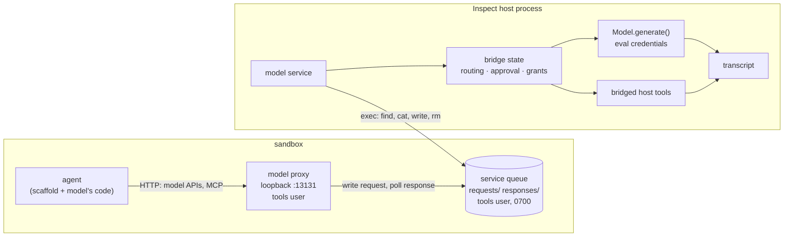
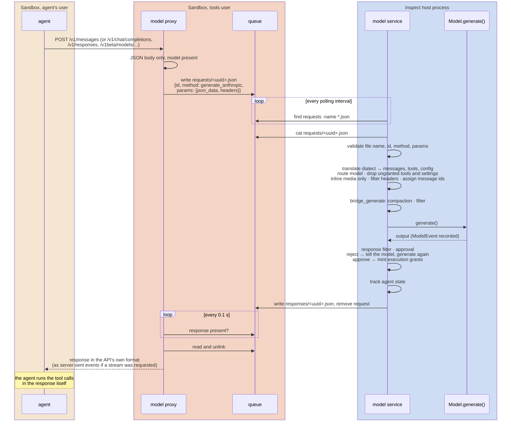

# Sandbox Agent Bridge: Architecture and Trust Boundary

## Overview

`sandbox_agent_bridge()` lets an eval run an existing agent (Claude Code,
Codex CLI, Gemini CLI, a custom program) inside a sandbox while Inspect keeps
the model layer on the host. The agent talks to a small HTTP proxy in the
sandbox, which relays each model request through a file queue to the Inspect
process; Inspect serves it with the eval's model, credentials, limits,
approval policies and transcript. The agent runs its own tools in the
sandbox; Inspect runs only the host-side tools the eval author chose to
expose ("bridged tools"), by default once for each approved call in a
response handed to the agent.

The trust boundary follows from that split. The sandbox contains the agent,
and the bridge cannot govern what the agent does there. What the bridge
guarantees is about the host: on the sandbox's behalf the host does only what
the eval's configuration grants, keeps its credentials to itself, and records
what it did.

## Scope

This is the bridge companion to
[sandbox-trust-model.md](sandbox-trust-model.md), which describes the
principals inside a sandbox, the in-sandbox privilege split and the three
boundaries (A, B and C) used below. It describes the sandbox bridge as built;
it is not a proposal. What is in and out of scope for security reports is the
[Scope](../SECURITY.md#scope) section of `SECURITY.md`, and the user guidance
is [Adversarial Models](../docs/agent-bridge.qmd#adversarial-models). This
document is consistent with both and describes the architecture behind them.

Facts owned elsewhere are linked, not repeated:

- [docs/agent-bridge.qmd](../docs/agent-bridge.qmd): the user contract for
  granted capabilities, bridged tools, model routing, generation and request
  settings, approval and the transcript;
  [docs/approval.qmd](../docs/approval.qmd#bridged-agents): approval
  decisions for bridged agents.
- [bridge-model-routing.md](bridge-model-routing.md): the resolution order
  for requested model names and why unrecognised names go to the eval's
  model.
- [bridge-host-tool-events.md](bridge-host-tool-events.md): how a bridged
  tool call is recorded and paired with its proposal, and which grant it
  consumes.
- [model-proxy-lifecycle.md](model-proxy-lifecycle.md): how the proxy is
  started and stopped through the sandbox tools server.
- [BINARY_INTEGRITY.md](../src/inspect_sandbox_tools/design/BINARY_INTEGRITY.md):
  whether the proxy binary injected into the sandbox is the one maintainers
  released.

The in-process `agent_bridge()` is out of scope. It shares the translation,
approval and recording described here (through the same
`bridge_generate()`), but its agent already has the host's network and
files, so it grants client model names, host media reads and provider-side
tools by default; don't use it with an adversarial model (see
[In-Process Bridge](../docs/agent-bridge.qmd#in-process-bridge)). The base
`AgentBridge` defaults media references and client-chosen model names
closed, so a new bridge subclass does not grant host reads or host
credentials by accident.

Paths below are relative to the repository root. `src/inspect_ai/` is
shortened to `ai/` and the injected package,
`src/inspect_sandbox_tools/src/inspect_sandbox_tools/`, to `guest/`.

## What the bridge is for

An eval that wants to measure a third-party agent as it ships has two
options: reimplement the agent's loop natively, or run the agent itself. The
bridge supports the second. The agent keeps its own tool loop, tools,
conversation store and configuration files, all inside the sandbox. Inspect
keeps what an eval needs from the model layer: the provider call under the
eval's credentials and `GenerateConfig`, model routing, limits, retries,
compaction, checkpointing, approval of the tool calls the model proposes, and
the transcript. How an agent is pointed at the proxy is in
[Sandbox Bridge](../docs/agent-bridge.qmd#sandbox-bridge).

## Components

| Component | Runs | As | Role | Code |
|---|---|---|---|---|
| **Agent** (the scaffold and every process the model starts through it) | Sandbox | The user the eval launches it as: the sandbox's default user unless the agent's `exec()` names another, or a sandbox identity scope's user | Drives the conversation and runs its own tools | Eval-supplied |
| **Model proxy** (`inspect-sandbox-tools model_proxy`) | Sandbox, loopback port 13131 by default | The tools user | HTTP server for the OpenAI Chat Completions, OpenAI Responses, Anthropic and Google APIs, plus one MCP endpoint per bridged tool server; relays each request through the service queue | `guest/_agent_bridge/proxy.py`, `guest/_agent_bridge/peer_uid.py` |
| **Service queue** | Sandbox filesystem: `/var/tmp/sandbox-services/bridge_model_service/<instance>/{requests,responses}` | Owned by the tools user, mode `0700` | One JSON file per request and per response | `ai/util/_sandbox/service.py` (`SandboxService`) |
| **Model service** | Inspect host process | Host | Polls the queue, translates each request, generates or runs a bridged tool, writes the response | `ai/agent/_bridge/sandbox/service.py` (`run_model_service`) |
| **Bridge state** | Inspect host process | Host | Model routing, approval, execution grants, message ids, the tracked agent state | `ai/agent/_bridge/types.py` (`AgentBridge`), `ai/agent/_bridge/sandbox/types.py` (`SandboxAgentBridge`) |
| **Bridged tools** (optional) | Inspect host process | Host | Host-side Inspect tools exposed to the agent as MCP tools at `http://localhost:<port>/mcp/<server>` | `ai/agent/_bridge/sandbox/host_tool.py` (`execute_host_tool`) |

The **tools user** is the identity Inspect's injected tools run as: root
where the sandbox lets the tools run as root, otherwise the sandbox's default
user (see
[Root access is decided before the agent runs](sandbox-trust-model.md#root-access-is-decided-before-the-agent-runs)).
The proxy is started as that user, and the model service's queue is created
private to it (`run_model_service` passes `user=sandbox._tools_user` to
`sandbox_service()`), so the proxy and the queue it writes to have one owner
in every configuration. The shared parent `/var/tmp/sandbox-services` is a
root-owned sticky directory where root is usable, and each directory below
it is prepared through the verified-directory helper (see
[Host verified directories](sandbox-trust-model.md#host-verified-directories)).

The proxy carries no credentials. It holds only its port, its queue
instance and, in a sandbox identity scope, the user it serves, all passed as
environment variables when it is started.

## Lifecycle

`sandbox_agent_bridge()` (`ai/agent/_bridge/sandbox/bridge.py`) is an async
context manager the eval's agent enters before it launches the scaffold:

1. It makes an instance id (`proxy_<uuid>`) and injects the sandbox tools
   (`sandbox_with_injected_tools`), which settles the tools user.
2. It resolves the granted capabilities: provider-side web search, code
   execution and client-declared MCP servers are withheld unless the eval
   grants them (see [Capabilities withheld by default](#capabilities-withheld-by-default)).
3. It constructs the `SandboxAgentBridge` and registers each
   `BridgedToolsSpec` as an MCP server at `/mcp/<name>`, refusing duplicate
   names, and warns when bridged tools share a description (see
   [Matching a Proposal](../docs/agent-bridge.qmd#bridged-tools-matching)).
4. It starts the model service in its own task group and waits until the
   service has prepared its queue.
5. It starts the proxy as an `exec_remote` job running as the tools user,
   outside the sandbox's concurrency limit, and starts two monitors: one
   fails the sample if the proxy exits with a failure (or, in a scope, exits
   before it listens), the other raises any failure a bridged generation or
   tool call asked the sample to fail with.
6. Inside a sandbox identity scope for its sandbox, it waits up to 60
   seconds for the proxy to report that it listens before going on (see
   [Sandbox identity scopes and the peer check](#sandbox-identity-scopes-and-the-peer-check)).
7. It yields the bridge. The agent launches the scaffold with
   `sandbox().exec()`; `bridge.state` and `bridge.mcp_server_configs` are
   available to it.
8. On exit it kills the proxy in a shielded scope and cancels the service.

A termination raised while serving a request ends the sample even when the
agent has already returned. A requested failure is raised once the agent
has unwound, in place of whatever error the scaffold
exited with. An error during cleanup after the agent completed successfully
is logged, not raised.

## Data flow

### One generation

The proxy serves its model and MCP routes over `POST` only. A `POST`
without an `application/json` object body is refused before any handler
runs, `OPTIONS` is answered with 405, and so is a `GET` to an MCP endpoint.
For a Google request the model is
taken from the URL path. Requests carry the client's headers to the host,
which filters them (Google requests forward none). The proxy limits request
headers and bodies (64 KiB and 50 MiB), and the host reads a queued request
with a 150 MiB limit, discarding one it can never read with an error reply.

The host lists the queue every 2 seconds, or at the sandbox provider's
default polling interval when that is longer. Each request runs in its own
task, so a slow generation does not hold up the others, and a request
already being served is not served again. Before reading a request the host
checks that the file is directly inside the requests directory and that its
name is a bounded token; after parsing it checks that the request's `id`
matches the file name, that its `method` is one of the service's six
methods (`generate_completions`, `generate_responses`, `generate_anthropic`,
`generate_google`, `list_tools`, `call_tool`) and that its `params` are an
object. The queue commands run as the tools user with their programs pinned
to the system directories, and responses are written through the verified
directory, never through a path another principal could redirect (see
[Verify before use](sandbox-trust-model.md#verify-before-use)). They are not
recorded as sandbox events.

The host's answer is complete before the proxy sees any of it. When the
client asked for a stream, the proxy replays the complete response as
server-sent events in the API's own event format (for Anthropic, it sends
the stream's opening event and keep-alive pings while it waits).

### One bridged tool call

`initialize` and `notifications/initialized` are answered by the proxy
itself; `tools/list` and `tools/call` go to the host as `list_tools` and
`call_tool`. `list_tools` returns each bridged tool's name, description and
input schema as the host serves them (`SandboxAgentBridge.served_tools`), and
those served descriptions are what later identifies the tool in the agent's
requests to the model. The execution order of `call_tool`, including what is
recorded for each refusal, is in
[bridge-host-tool-events.md](bridge-host-tool-events.md#how-a-request-is-recorded).

## What the host does with a request

### Translation

Each API has an implementation module that turns the client's body into
Inspect messages, tool definitions, tool choice and a `GenerateConfig`
(`ai/agent/_bridge/{completions,responses_impl,anthropic_api_impl,google_api_impl}.py`).
Every dialect then goes through `bridge_generate()` in
`ai/agent/_bridge/util.py`, the one place where compaction, the bridge's
`filter` and `response_filter`, refusal retries, approval and grant
registration happen. After it returns, the dialect updates the tracked agent
state and builds the response.

The history in a request is accepted as the agent sent it: user, assistant,
system and tool-result messages are all the agent's to write. The bridge
restores the provenance of operator messages a scaffold re-sends as plain
user messages, so they keep their `source` in the record.

### Model routing

The eval's configuration, never the requested name alone, decides which
model serves a request (`resolve_bridge_model()` in
`ai/agent/_bridge/util.py`; the order is
[Models](../docs/agent-bridge.qmd#models) and
[Resolution order](bridge-model-routing.md#resolution-order)). A name the
client sends never reaches `get_model()` on the sandbox bridge, so a model
role is reachable only through an alias, the resolver or the `model` pin,
all host-side configuration.

### Generation settings

The client's generation parameters are dropped unless the eval sets
`forward_generation_config=True` (see
[Generation Config](../docs/agent-bridge.qmd#generation-config)), and other
request fields follow the
[Request Settings](../docs/agent-bridge.qmd#request-settings) policy, which
says which the eval decides and which are forwarded.

### Capabilities withheld by default

Provider-side tools, client-declared MCP servers, client headers other
than `Accept-Encoding`, and models other than the eval's are withheld unless
the eval grants them, and media by URL or path is always refused (see
[Granted Capabilities](../docs/agent-bridge.qmd#granted-capabilities),
[Models](../docs/agent-bridge.qmd#models) and
[Remote MCP Servers](../docs/approval.qmd#remote-mcp)). A withheld tool is
dropped from the request rather than failing it, and a tool choice that
named it falls back to `auto`, so the agent's own function tools still reach
the model.

### Errors and limits

A failed generation is returned to the scaffold as an error response in the
API's own format. A token, cost, message or turn limit reached in a bridged
generation is returned the same way and recorded on the bridge. Once a limit
is recorded the agent's generations stop: a later generation request gets
the recorded limit's error without a provider call, and a request already in
flight makes no further provider call. A granted host tool's provider
dispatches are refused the same way; the tool reports an error only if it
lets the refusal propagate. Both go through
`_refuse_after_a_recorded_limit()` in `ai/agent/_bridge/sandbox/service.py`
and `dispatch_guard()` in `ai/model/_model.py`. Utility inference run with limits suspended, such as a
model-backed approver reviewing a response already in flight, is not the
agent's and can still run. Granted tools that make no model call, and
`list_tools`, still work. The bridge does not stop the scaffold. It raises the recorded limit once the agent unwinds, so
the scope that set it handles it as it would for a native agent. Which limit
stays recorded when more than one is reached is in
`_forward_provider_errors()` and `_encloses()` in
`ai/agent/_bridge/sandbox/service.py`.

A termination (an approver's `terminate`, three consecutive rejections, a
filter) ends the sample. A refusal under `fail_on_refusal`, an error in a
`response_filter`, and an unexpected error in a bridged host tool fail the
sample through the bridge's failure monitor; the host attempts an error
reply to the scaffold, which the sample's teardown can pre-empt.

## Approval and execution grants

Approval of a bridged agent's tool calls, and the rule that a bridged tool
runs only once per proposed call with the arguments as approved, are the
user contract in [Bridged Agents](../docs/approval.qmd#bridged-agents),
[Tool Approval](../docs/agent-bridge.qmd#tool-approval),
[Execution Contract](../docs/agent-bridge.qmd#bridged-tools-execution) and
[Matching a Proposal](../docs/agent-bridge.qmd#bridged-tools-matching).
Which pending grant a request consumes, and how executions pair with their
proposals, is in
[bridge-host-tool-events.md](bridge-host-tool-events.md#pairing-with-the-proposal).
What those pages leave out:

- Approval runs in `bridge_generate()` (`ai/agent/_bridge/_approval.py`)
  after each generation, and an active sentinel's tool-call check runs at
  the same point, before the response is handed to the agent.
- Grants are recorded by `SandboxAgentBridge.register_tool_execution_grants`
  and consumed by `consume_tool_execution_grant`; a proposed call is tied to
  a bridged tool by `_proposed_call` and `_resolve_by_served_content` (all in
  `ai/agent/_bridge/sandbox/types.py`).
- A grant is matched by server, tool and arguments, not by proposal, so a
  retried `tools/call` is denied only when no matching grant remains: if the
  model proposed the same call more than once, a retry consumes another
  proposal's grant.

## What Inspect records

| What happened | Executes | Inspect can refuse it | Recorded as |
|---|---|---|---|
| A generation the host performs | At the model provider, with the eval's credentials | Yes: routing, withheld capabilities, limits | `ModelEvent` |
| The agent's own tool calls | In the sandbox, by the agent | Only the proposal, at approval | In the `ModelEvent` that proposed them; results only as the agent reports them in later requests |
| Provider-side tools, when granted | At the model provider | By not granting them | Inside the `ModelEvent` |
| A bridged host tool request | In the Inspect process | Yes: grant check, schema validation | `ToolEvent`, executed or not |
| An approval decision | In the Inspect process | (it is the refusal) | `ApprovalEvent` |

The `requested_model` field of a client request's `ModelEvent` and the
`ToolEvent` of each `call_tool` request are described in
[Models](../docs/agent-bridge.qmd#models),
[Transcript](../docs/agent-bridge.qmd#transcript) and
[bridge-host-tool-events.md](bridge-host-tool-events.md). Compaction and
approver generations are recorded too, without a requested name. Two
mechanics are found only in the code:

- **Message ids.** A request carries no Inspect message ids, so the bridge
  assigns them (`AgentBridge._assign_message_ids`) so that the same message
  keeps one id across requests, in `ModelEvent` inputs and in the sample's
  messages. A tool call whose id is empty or already names another call is
  handed to the agent under a fresh id, while the `ModelEvent` keeps the
  model's (`_fresh_call_ids` in `ai/agent/_bridge/util.py`).
- **Agent state.** `bridge.state` is assembled from the traffic by
  heuristics that pick the agent's main conversation thread
  (`AgentBridge._track_state`), so it can hold a sub-agent's conversation
  when it is read. Like the history in each request, it is the agent's
  account of the conversation.

## Principals

The [sandbox trust model](sandbox-trust-model.md#attacker-positions) treats
the evaluated model as the primary adversary, able to run arbitrary code as
the user its tools run as. For the bridge:

| Principal | Where | Trusted | Holds or controls |
|---|---|---|---|
| Inspect host process | Host | Yes | Provider credentials, model routing, approval policies, limits, bridged tools, the transcript |
| Eval author | Host-side configuration | Yes | Every grant: capabilities, aliases, bridged tools, `require_proposal`, the user the agent runs as |
| Agent | Sandbox, as the user it is launched as | No | The scaffold, its configuration and session files, every process the model starts through it, and every request it sends |
| Tools user | Sandbox | No | The proxy and its queue; root where usable, otherwise the default user |
| Other processes in the sandbox | Sandbox, as their own users | No | Sidecars, other agents in a multi-agent sandbox, other sandbox users |
| Model provider | External | No | Receives what the host sends |

The host does not trust the tools user: it treats every request that
reaches it through the queue as untrusted, and the tools user is separate
from the agent only where Boundary A holds (see
[Relationship to the sandbox trust model](#relationship-to-the-sandbox-trust-model)).
The eval chooses the model provider and sends it its credentials and the
conversation; the provider's responses are the evaluated model's output,
which this trust model treats as the adversary.

The scaffold and the code the model runs through it are one principal. They
run as the same user, so nothing the bridge could check (a token, a file the
scaffold reads, a socket's owner) tells a request the scaffold made from one
the model's code made. The question the bridge answers is therefore not
which process is calling, but what the host is willing to do for the
sandbox and what it writes down.

## The trust boundary

### What the bridge cannot be

The bridge is not a mediator of the agent's actions, and the transcript is
not an independent record of the agent's tool use (see
[Adversarial Models](../docs/agent-bridge.qmd#adversarial-models)). Inspect
sees a tool call only as part of a model response, and can decline to hand
over a proposal but cannot stop the agent acting without asking. So guarantee
4 of the sandbox trust model ("a tool call Inspect declines is not executed
by any route") holds on the bridge only for bridged host tools on servers
that require a proposal (not those registered with
`require_proposal=False`): for the agent's own tools the sandbox, not the
bridge, contains what the agent does.

### What it guarantees

These are the bridge's architecture guarantees, about the host and the
host's record. What is reportable as a vulnerability is defined by
`SECURITY.md`'s [In scope](../SECURITY.md#in-scope) list, which for the
bridge names an agent in a sandbox using it to get a capability the
evaluation did not grant, read API keys kept on the host, run code in the
Inspect process, or reach another sample's model calls.

1. **Granted capability only.** On the sandbox's behalf the host performs
   only generations by models the eval's configuration chose, provider-side
   tools and remote MCP servers the eval granted, and executions of host
   tools the eval bridged, each once per approved call in a response handed
   to the agent, whether the model proposed it or one of the eval's own
   filters supplied it (unless the server opted out with
   `require_proposal=False`). It reads no media by URL or path, forwards no
   header the eval did not allow other than `Accept-Encoding`, and handles
   request settings as the
   [Request Settings](../docs/agent-bridge.qmd#request-settings) policy
   says. Nothing in a request widens this set. *(Boundary B)*
2. **Credentials stay on the host.** The proxy and the queue carry no
   credentials; the host adds them when it calls the provider. A client
   cannot supply or override a credential header. *(Boundary B)*
3. **No code runs on the host on the sandbox's say.** A request is data: a
   method name from a fixed set of six, and parameters the host parses into
   its own types. The only code a request can run on the host is a bridged
   tool the eval registered, with arguments validated against its schema.
   *(Boundary B)*
4. **Requests stay in their sample.** A request is served in the sample of
   the bridge whose queue it reached, under that sample's model, limits,
   approval policies and transcript. *(Boundary B)*
5. **The record is true to what the host did.** Every generation the host
   performs for the bridge is a `ModelEvent` recording the model that served
   it, and the event of each client request also records the name the client
   asked for; every bridged tool request is a `ToolEvent` whether or not it
   ran, and every approval decision is an `ApprovalEvent`. The record does
   not claim what the agent then did with a response. *(Boundary C)*
6. **Limits bind.** Limits apply to bridged generations as to native ones.
   Once one is reached, the agent gets no further generations, and the limit
   is raised in the scope that set it (see [Errors and limits](#errors-and-limits)).
   *(Boundary C)*
7. **Not a browser service.** The proxy sends no cross-origin headers,
   answers no preflight and accepts only JSON object bodies (see
   [Sandbox Bridge](../docs/agent-bridge.qmd#sandbox-bridge)).
8. **In a sandbox identity scope, one user.** The proxy serves only sockets
   the scope's user owns, and the queue behind it is private to the tools
   user, so a sandbox user other than those two and root can reach neither
   (see
   [the next section](#sandbox-identity-scopes-and-the-peer-check)).

### What stays outside the guarantee

What the bridge does not guarantee is `SECURITY.md`'s
[Out of scope](../SECURITY.md#out-of-scope) list, the limits under
[Adversarial Models](../docs/agent-bridge.qmd#adversarial-models) and the
[sandbox trust model's out-of-scope list](sandbox-trust-model.md#out-of-scope).
Where Boundary A is absent, see the Boundary A bullet of
[Relationship to the sandbox trust model](#relationship-to-the-sandbox-trust-model).

## Sandbox identity scopes and the peer check

A sandbox bridge entered inside a
[sandbox identity scope](sandbox-trust-model.md#sandbox-identity-scopes)
for its sandbox serves only connections from sockets the scope's user owns;
outside a scope it serves every process in its sandbox, as `SECURITY.md`
states. The mechanism and its limits (the check identifies a user, not a
process) are the "Bridge peer check" bullet of that section; the code is
`guest/_agent_bridge/peer_uid.py`.

## Relationship to the sandbox trust model

The sandbox trust model's boundaries apply to the bridge as follows:

- **Boundary B** (sandbox to host capability) is the bridge's main boundary:
  the proxy and queue are a channel from the sandbox into the host, and
  guarantees 1 to 4 above refine that document's guarantee 3 ("the agent
  cannot invoke host-side capability outside the paths Inspect mediates")
  for this channel.
- **Boundary C** (mediation) is weak by construction for the agent's own
  tools, as that document says of Pattern 2; guarantees 5 and 6 above are
  what the bridge supplies instead: a true record of what the host did, and
  limits that stop the agent's further generations and reach the scope that
  set them.
- **Boundary A** (in-sandbox privilege) touches the bridge through the
  proxy's identity and its queue's owner, both the tools user. Where
  Boundary A is present, the agent cannot read or write the queue; where it
  is absent (the agent runs as the tools user, as when root is not usable
  and the agent runs as the default user), the queue is no barrier, and that
  is out of scope.

The sandbox trust model's invariant holds with one qualification. Reaching
the channel is still not authorization: the host decides what to do from
its own configuration, not from the request. But the principal that
reaches the channel is, by design, the one it was built for, so the bridge's
controls are on what the host does and records, not on who is calling.

## Changing the bridge

A change to the sandbox bridge should be able to answer:

- Does it let a request widen what the host does on the sandbox's behalf: a
  model, a provider-side capability, a header or request setting, a host
  read, a host tool execution? If so, is that capability off by default and
  granted only by host-side configuration?
- Does every generation it makes still go through `bridge_generate()`, so
  approval, grants, limits and recording apply?
- Does a host tool still run only on a consumed grant, unless its server
  opted out?
- Does the record still say what the host did: a `ModelEvent` for each
  generation, with `requested_model` for each client request, and a
  `ToolEvent` for each `call_tool`?
- Does it treat everything in a request, the history and tool results
  included, as the agent's account?
- Does anything new it creates in the sandbox follow the
  [verified-directory and verify-before-use contracts](sandbox-trust-model.md#contracts),
  owned by the tools user?
- Does it keep [SECURITY.md](../SECURITY.md#scope) and
  [Adversarial Models](../docs/agent-bridge.qmd#adversarial-models) accurate?

A change that alters a component, a principal or a guarantee described here
updates this document in the same pull request.
