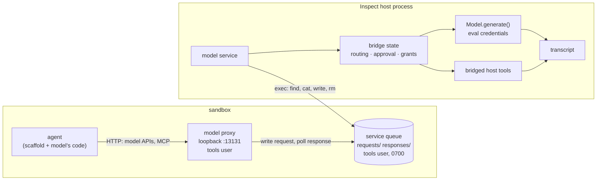
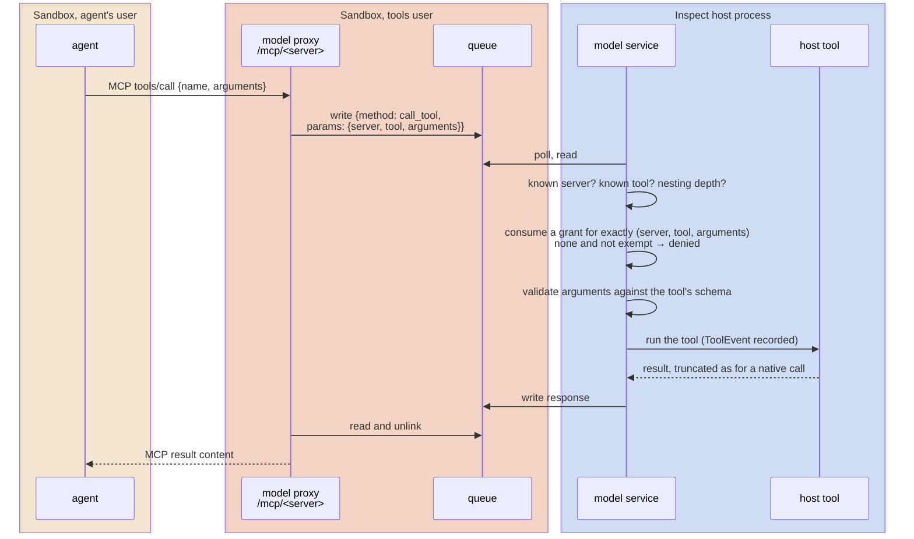

# Sandbox Agent Bridge: Architecture and Trust Boundary

## Overview

`sandbox_agent_bridge()` lets an eval run an existing agent (Claude Code,
Codex CLI, Gemini CLI, a custom program) inside a sandbox while Inspect keeps
the model layer on the host. The agent is pointed at a small HTTP proxy that
Inspect starts inside the sandbox. The proxy speaks the OpenAI, Anthropic and
Google APIs, and relays each request through a file queue to the Inspect
process, which serves it with the eval's model, credentials, configuration,
limits, approval policies and transcript, and writes the response back. The
agent runs its own tools in the sandbox; Inspect sees its model calls and
runs only the host-side tools the eval author chose to expose ("bridged
tools"), once for each call the model proposed.

The trust boundary follows from that split. The sandbox contains the agent;
the bridge cannot govern what the agent does there. What the bridge
guarantees is about the host: on the sandbox's behalf the host does only what
the eval's configuration grants, keeps its credentials to itself, and records
what it did. This document describes the components, how a request flows,
what the host does with it, and which guarantees the bridge does and does not
make.

## Scope

This is the bridge companion to
[sandbox-trust-model.md](sandbox-trust-model.md), which describes the
principals inside a sandbox, the in-sandbox privilege split and the three
boundaries (A, B and C) used below. It describes the sandbox bridge as built;
it is not a proposal. The public statement of what is in and out of scope for
security reports is the [Scope](../SECURITY.md#scope) section of
`SECURITY.md`, and the user guidance is
[Adversarial Models](../docs/agent-bridge.qmd#adversarial-models) in the
agent bridge documentation. This document is consistent with both and
explains the architecture behind them.

Mechanics documented elsewhere are linked, not repeated:

- [model-proxy-lifecycle.md](model-proxy-lifecycle.md): how the proxy is
  started and stopped through the sandbox tools server.
- [bridge-model-routing.md](bridge-model-routing.md): the rationale for
  routing unrecognised model names to the eval's model.
- [bridge-host-tool-events.md](bridge-host-tool-events.md): how a bridged
  tool call is recorded and paired with its proposal, and which grant it
  consumes.
- [docs/agent-bridge.qmd](../docs/agent-bridge.qmd): the user contract for
  granted capabilities, bridged tools, model routing, generation and request
  settings, approval and the transcript.
- [BINARY_INTEGRITY.md](../src/inspect_sandbox_tools/design/BINARY_INTEGRITY.md):
  whether the proxy binary injected into the sandbox is the one maintainers
  released.

The in-process `agent_bridge()` is out of scope: there the agent and its
tools run in the Inspect process with the host's network and files, so there
is no boundary to describe (see [Not the in-process bridge](#not-the-in-process-bridge)).

Paths below are relative to the repository root. `src/inspect_ai/` is
shortened to `ai/` and the injected package,
`src/inspect_sandbox_tools/src/inspect_sandbox_tools/`, to `guest/`.

## What the bridge is for

An eval that wants to measure a third-party agent as it ships has two
options: reimplement the agent's loop natively, or run the agent itself. The
bridge supports the second. The agent keeps its own tool loop, tools,
conversation store and configuration files, all inside the sandbox. Inspect
keeps what an eval needs from the model layer: the provider call under the
eval's credentials and `GenerateConfig`, model routing, token, cost, message
and turn limits, retries, compaction, checkpointing, approval of the tool
calls the model proposes, and the transcript.

The agent is configured to send its model traffic to the proxy
(`OPENAI_BASE_URL=http://localhost:13131/v1`,
`ANTHROPIC_BASE_URL=http://localhost:13131`,
`GOOGLE_GEMINI_BASE_URL=http://localhost:13131/v1beta`) and usually to name
the model `inspect`. Nothing else about the agent changes.

## Components

| Component | Runs | As | Role | Code |
|---|---|---|---|---|
| **Agent** (the scaffold and every process the model starts through it) | Sandbox | The user the eval launches it as: the sandbox's default user unless the agent's `exec()` names another, or a sandbox identity scope's user | Drives the conversation and runs its own tools | Eval-supplied |
| **Model proxy** (`inspect-sandbox-tools model_proxy`) | Sandbox, loopback port 13131 by default | The tools user | HTTP server for the OpenAI Chat Completions, OpenAI Responses, Anthropic and Google APIs, plus one MCP endpoint per bridged tool server; relays each request through the service queue | `guest/_agent_bridge/proxy.py`, `guest/_agent_bridge/peer_uid.py` |
| **Service queue** | Sandbox filesystem: `/var/tmp/sandbox-services/bridge_model_service/<instance>/{requests,responses}` | Owned by the tools user, mode `0700` | One JSON file per request and per response | `ai/util/_sandbox/service.py` (`SandboxService`) |
| **Model service** | Inspect host process | Host | Polls the queue, translates each request, generates or runs a bridged tool, writes the response | `ai/agent/_bridge/sandbox/service.py` (`run_model_service`) |
| **Bridge state** | Inspect host process | Host | Model routing, approval, execution grants, message ids, the tracked agent state | `ai/agent/_bridge/types.py` (`AgentBridge`), `ai/agent/_bridge/sandbox/types.py` (`SandboxAgentBridge`) |
| **Bridged tools** (optional) | Inspect host process | Host | Host-side Inspect tools exposed to the agent as MCP tools at `http://localhost:<port>/mcp/<server>` | `ai/agent/_bridge/sandbox/host_tool.py` (`execute_host_tool`) |

The **tools user** is the identity Inspect's injected tools run as: root
where the sandbox lets the tools run as root, otherwise the sandbox's default
user (see
[Root access is decided before the agent runs](sandbox-trust-model.md#root-access-is-decided-before-the-agent-runs)).
The proxy is started as that user, and the model service's queue is created
private to it (`run_model_service` passes `user=sandbox._tools_user` to
`sandbox_service()`), so the proxy and the queue it writes to have one owner
in every configuration. The shared parent `/var/tmp/sandbox-services` is a
root-owned sticky directory where root is usable, and each directory below
it is prepared through the verified-directory helper (see
[Host verified directories](sandbox-trust-model.md#host-verified-directories)).

The proxy carries no credentials. It holds only its port, its queue
instance and, in a sandbox identity scope, the user it serves, all passed as
environment variables when it is started.



## Lifecycle

`sandbox_agent_bridge()` (`ai/agent/_bridge/sandbox/bridge.py`) is an async
context manager the eval's agent enters before it launches the scaffold:

1. It makes an instance id (`proxy_<uuid>`) and injects the sandbox tools
   (`sandbox_with_injected_tools`), which settles the tools user.
2. It resolves the granted capabilities: provider-side web search, code
   execution and client-declared MCP servers are withheld unless the eval
   grants them (see [Capabilities withheld by default](#capabilities-withheld-by-default)).
3. It constructs the `SandboxAgentBridge` and registers each
   `BridgedToolsSpec` as an MCP server at `/mcp/<name>`, refusing duplicate
   names, and warns when bridged tools share a description (see
   [Bridged tool identity](#bridged-tool-identity)).
4. It starts the model service in its own task group and waits until the
   service has prepared its queue.
5. It starts the proxy as an `exec_remote` job running as the tools user,
   outside the sandbox's concurrency limit, and starts two monitors: one
   fails the sample if the proxy exits with a failure (or, in a scope, exits
   before it listens), the other raises any failure a bridged generation or
   tool call asked the sample to fail with.
6. Inside a sandbox identity scope for its sandbox, it waits up to 60
   seconds for the proxy to report that it listens before going on (see
   [Sandbox identity scopes and the peer check](#sandbox-identity-scopes-and-the-peer-check)).
7. It yields the bridge. The agent launches the scaffold with
   `sandbox().exec()`; `bridge.state` and `bridge.mcp_server_configs` are
   available to it.
8. On exit it kills the proxy in a shielded scope and cancels the service.

A termination raised while serving a request ends the sample even when the
agent has already returned. A requested failure or a generation limit is
raised once the agent has unwound, in place of whatever error the scaffold
exited with. An error during cleanup after the agent completed successfully
is logged, not raised.

## Data flow

### One generation

```mermaid
sequenceDiagram
    box rgba(255, 170, 60, 0.18) Sandbox, agent's user
        participant A as agent
    end
    box rgba(255, 110, 40, 0.22) Sandbox, tools user
        participant P as model proxy
        participant Q as queue
    end
    box rgba(70, 140, 255, 0.20) Inspect host process
        participant S as model service
        participant M as Model.generate()
    end

    A->>P: POST /v1/messages (or /v1/chat/completions,<br/>/v1/responses, /v1beta/models/...)
    P->>P: JSON body only; model present
    P->>Q: write requests/<uuid>.json<br/>{id, method: generate_anthropic,<br/>params: {json_data, headers}}
    loop every polling interval
        S->>Q: find requests -name *.json
    end
    S->>Q: cat requests/<uuid>.json
    S->>S: validate file name, id, method, params
    S->>S: translate dialect → messages, tools, config<br/>route model · drop ungranted tools and settings<br/>inline media only · filter headers · assign message ids
    S->>S: bridge_generate: compaction · filter
    S->>M: generate()
    M-->>S: output (ModelEvent recorded)
    S->>S: response filter · approval<br/>reject → tell the model, generate again<br/>approve → mint execution grants
    S->>S: track agent state
    S->>Q: write responses/<uuid>.json, remove request
    loop every 0.1 s
        P->>Q: response present?
    end
    P->>Q: read and unlink
    P-->>A: response in the API's own format<br/>(as server-sent events if a stream was requested)
    Note over A: the agent runs the tool calls<br/>in the response itself
```

The proxy serves its model and MCP routes over `POST` only. A `POST`
without an `application/json` object body is refused before any handler
runs, `OPTIONS` is answered with 405, and so is a `GET` to an MCP endpoint.
For a Google request the model is
taken from the URL path. Requests carry the client's headers to the host,
which filters them (Google requests forward none). The proxy limits request
headers and bodies (64 KiB and 50 MiB), and the host reads a queued request
with a 150 MiB limit, discarding one it can never read with an error reply.

The host lists the queue every 2 seconds, or at the sandbox provider's
default polling interval when that is longer. Each request runs in its own
task, so a slow generation does not hold up the others, and a request
already being served is not served again. Before reading a request the host
checks that the file is directly inside the requests directory and that its
name is a bounded token; after parsing it checks that the request's `id`
matches the file name, that its `method` is one of the service's six
methods (`generate_completions`, `generate_responses`, `generate_anthropic`,
`generate_google`, `list_tools`, `call_tool`) and that its `params` are an
object. The queue commands run as the tools user with their programs pinned
to the system directories, and responses are written through the verified
directory, never through a path another principal could redirect (see
[Verify before use](sandbox-trust-model.md#verify-before-use)). They are not
recorded as sandbox events.

The host's answer is complete before the proxy sees any of it. When the
client asked for a stream, the proxy replays the complete response as
server-sent events in the API's own event format (for Anthropic, it sends
the stream's opening event and keep-alive pings while it waits).

### One bridged tool call



`initialize` and `notifications/initialized` are answered by the proxy
itself; `tools/list` and `tools/call` go to the host as `list_tools` and
`call_tool`. `list_tools` returns each bridged tool's name, description and
input schema as the host serves them (`SandboxAgentBridge.served_tools`), and
those served descriptions are what later identifies the tool in the agent's
requests to the model. The execution order of `call_tool`, including what is
recorded for each refusal, is in
[bridge-host-tool-events.md](bridge-host-tool-events.md#how-a-request-is-recorded).

## What the host does with a request

### Translation

Each API has an implementation module that turns the client's body into
Inspect messages, tool definitions, tool choice and a `GenerateConfig`
(`ai/agent/_bridge/{completions,responses_impl,anthropic_api_impl,google_api_impl}.py`).
Every dialect then goes through `bridge_generate()` in
`ai/agent/_bridge/util.py`, the one place where compaction, the bridge's
`filter` and `response_filter`, refusal retries, approval and grant
registration happen. After it returns, the dialect updates the tracked agent
state and builds the response.

The history in a request is accepted as the agent sent it: user, assistant,
system and tool-result messages are all the agent's to write. The bridge
restores the provenance of operator messages a scaffold re-sends as plain
user messages, so they keep their `source` in the record.

### Model routing

The eval's configuration, never the requested name alone, decides which
model serves a request. `resolve_bridge_model()` in `ai/agent/_bridge/util.py`
resolves the name the client sent, in order:

1. a name in `model_aliases` goes to the model it maps to;
2. otherwise `model_resolver`, if set, is called with the name (qualified
   with the endpoint's provider, e.g. `anthropic/claude-haiku-5-5`) and may
   return a model;
3. `inspect` goes to the eval's active model;
4. with a `model` pin, every other name goes to the pinned model;
5. a name that denotes the active model goes to the eval's own `Model`
   instance, so the eval's generation config applies;
6. any other name, including `inspect/<model>` names and model role names,
   goes to the eval's active model, with a warning once per name.

A name the client sends never reaches `get_model()` on the sandbox bridge:
step 6 calls `get_model()` with no arguments. A model role is reachable only
through an alias, the resolver or the pin, all host-side configuration.
`ModelEvent.requested_model` records the name the client sent, so a redirect
can be told apart from a call the agent made by name (see
[What Inspect records](#what-inspect-records)). The user contract is
[Models](../docs/agent-bridge.qmd#models); why unrecognised names go to the
eval's model is in [bridge-model-routing.md](bridge-model-routing.md).

### Generation settings

By default the client's generation parameters (`max_tokens`, temperature,
reasoning effort and the others listed in
[Generation Config](../docs/agent-bridge.qmd#generation-config)) are
dropped, since the agent tuned them for the model it thinks it is calling.
Structural parameters (system prompt, tools, tool choice, response format,
stop sequences, seed) are always forwarded. With
`forward_generation_config=True` the client's parameters are forwarded, and
the Inspect model's own configuration still takes precedence over them.

Settings that change billing, provider-side storage or retained context
(`service_tier`, `store`, `truncation`) and the options of provider tools the
agent declares are decided by the eval's configuration; a Responses request
with `previous_response_id` is refused (see
[Request Settings](../docs/agent-bridge.qmd#request-settings)).

### Capabilities withheld by default

Some things a request can ask for would make the host act outside the
sandbox on the agent's behalf. The sandbox bridge withholds each unless the
eval grants it (see
[Granted Capabilities](../docs/agent-bridge.qmd#granted-capabilities)):

| Capability | Default | Grant |
|---|---|---|
| Provider-side web search (and Anthropic web fetch, which comes with it) | Withheld, with a warning | `web_search=` |
| Provider-side code execution | Withheld, with a warning | `code_execution=` |
| MCP servers the agent declares (run by the provider) | Withheld, with a warning | `client_mcp_servers=True`; refused while an approval policy is active, whatever the grant |
| Media by URL or path | Refused: media must be an inline `data:` URI | None on the sandbox bridge |
| Client HTTP headers | Dropped, except `Accept-Encoding` | `forward_client_headers=`; credential and transport headers can never be listed |
| A model other than the eval's | Not reachable by name | `model_aliases`, `model_resolver`, `model` |
| Host tools | Only those the eval bridges, once per proposed call | `bridged_tools=`; `require_proposal=False` per server |

A withheld tool is dropped from the request rather than failing it, and a
tool choice that named it falls back to `auto`, so the agent's own function
tools still reach the model. Function tools the agent declares are never
withheld: the agent runs them in the sandbox, and they grant it nothing it
does not already have.

### Errors and limits

A failed generation is returned to the scaffold as an error response in the
API's own format. A token, cost, message or turn limit reached in a bridged
generation is returned the same way and recorded on the bridge. Once a limit
is recorded the host makes no further generation for the bridge: later
generation requests, and model calls a bridged tool makes, get the recorded
limit's error without a provider call. The bridge does not stop the
scaffold. It raises the recorded limit once the agent unwinds, so the scope
that set it handles it as it would for a native agent. Which limit stays
recorded when more than one is reached is in `_forward_provider_errors()` and
`_encloses()` in `ai/agent/_bridge/sandbox/service.py`.

A termination (an approver's `terminate`, three consecutive rejections, a
filter) ends the sample. A refusal under `fail_on_refusal`, an error in a
`response_filter`, and an unexpected error in a bridged host tool fail the
sample through the bridge's failure monitor, while the scaffold still gets
an error reply.

## Approval on the bridge

A bridged agent runs its own tool loop, so Inspect never dispatches the
agent's own calls and the native `execute_tools()` approval path never runs.
Approval runs instead on the tool calls in each model response, in
`bridge_generate()` (`ai/agent/_bridge/_approval.py`), before the response
is handed to the agent; an active sentinel's tool-call check runs at the
same point. A rejected call is replayed to the model with an explanation
rather than edited out, so the agent sees only the replacement. The user
contract, including termination after repeated rejections and multi-choice
responses, is [Bridged Agents](../docs/approval.qmd#bridged-agents) and
[Tool Approval](../docs/agent-bridge.qmd#tool-approval).

Approval decides what the agent is handed, not what it does: the agent can
run any command it likes in the sandbox without asking the model. Approval
is a control on host action only for bridged tools, through execution
grants.

### Execution grants

Each tool call in a response handed to the agent becomes one grant
(`SandboxAgentBridge.register_tool_execution_grants`), binding the bridged
server and tool the call denotes and the arguments as approved, or as an
approver modified them. `call_tool` consumes a matching grant before it runs
a host tool and denies a request with none, whether or not an approval
policy is active (`consume_tool_execution_grant`). A grant permits one
execution and is matched by server, tool and arguments, not by proposal, so
a retried `tools/call` is denied only when no matching grant remains. A
server registered with `BridgedToolsSpec(require_proposal=False)` is the
only opt-out: its tools run for any `tools/call` it receives.

Argument matching is in `consume_tool_execution_grant()`
(`ai/agent/_bridge/sandbox/types.py`). Which pending grant a request
consumes, how grants are bounded, and what they record for an exempt server
are in [Pairing with the proposal](bridge-host-tool-events.md#pairing-with-the-proposal)
and [Execution ids](bridge-host-tool-events.md#execution-ids). The user
contract is [Execution Contract](../docs/agent-bridge.qmd#bridged-tools-execution).

### Bridged tool identity

Agents rename MCP tools for their models, so a proposed call is tied to a
bridged tool by the description its declaration carries, matched against
the description the host served in `tools/list`, not by name
(`_resolve_by_served_content` in `ai/agent/_bridge/sandbox/types.py`). A
declaration that matches no served description denotes nothing, and a call
to it grants nothing. Approval reviews each call as the bridged tool its
grant will bind, so a policy written for a bridged tool applies whatever
name the agent used. When bridged tools share a description, a call to any
of them must pass every review, gets one grant per tool, and fails the
sample on a `modify`; the bridge warns at setup, naming such tools. The
matching rules, including truncated descriptions and the recognised
dispatcher shape, are
[Matching a Proposal](../docs/agent-bridge.qmd#bridged-tools-matching).

## What Inspect records

| What happened | Executes | Inspect can refuse it | Recorded as |
|---|---|---|---|
| A generation the host performs | At the model provider, with the eval's credentials | Yes: routing, withheld capabilities, limits | `ModelEvent` |
| The agent's own tool calls | In the sandbox, by the agent | Only the proposal, at approval | In the `ModelEvent` that proposed them; results only as the agent reports them in later requests |
| Provider-side tools, when granted | At the model provider | By not granting them | Inside the `ModelEvent` |
| A bridged host tool request | In the Inspect process | Yes: grant check, schema validation | `ToolEvent`, executed or not |
| An approval decision | In the Inspect process | (it is the refusal) | `ApprovalEvent` |

- **`ModelEvent`.** Every generation the host performs on the bridge's
  behalf is a `ModelEvent`, including those a `filter`, compaction or an
  approver makes. The event of the client's request records the name the
  client sent in `requested_model` (`ai/event/_model.py`) and the model that
  served it in `model`.
- **`ToolEvent` for `call_tool`.** Every `call_tool` request is one
  `ToolEvent`, whether it ran, was denied or was rejected, with
  `metadata["bridge"]` naming the server, the tool and the grant outcome.
  How each event pairs with its proposal and which one takes the proposing
  call's id are in
  [bridge-host-tool-events.md](bridge-host-tool-events.md#pairing-with-the-proposal);
  see also [Transcript](../docs/agent-bridge.qmd#transcript).
- **Message ids.** A request carries no Inspect message ids, so the bridge
  assigns them (`AgentBridge._assign_message_ids`) so that the same message
  keeps one id across requests, in `ModelEvent` inputs and in the sample's
  messages. A tool call whose id is empty or already names another call is
  handed to the agent under a fresh id, while the `ModelEvent` keeps the
  model's (`_fresh_call_ids` in `ai/agent/_bridge/util.py`).
- **Agent state.** `bridge.state` is assembled from the traffic by
  heuristics that pick the agent's main conversation thread
  (`AgentBridge._track_state`), so it can hold a sub-agent's conversation
  when it is read. Like the history in each request, it is the agent's
  account of the conversation.

## Principals

The [sandbox trust model](sandbox-trust-model.md#attacker-positions) treats
the evaluated model as the primary adversary, able to run arbitrary code as
the user its tools run as. For the bridge:

| Principal | Where | Trusted | Holds or controls |
|---|---|---|---|
| Inspect host process | Host | Yes | Provider credentials, model routing, approval policies, limits, bridged tools, the transcript |
| Eval author | Host-side configuration | Yes | Every grant: capabilities, aliases, bridged tools, `require_proposal`, the user the agent runs as |
| Agent | Sandbox, as the user it is launched as | No | The scaffold, its configuration and session files, every process the model starts through it, and every request it sends |
| Tools user | Sandbox | Inspect's identity in the sandbox | The proxy and its queue; root where usable, otherwise the default user |
| Other processes in the sandbox | Sandbox, as their own users | No | Sidecars, other agents in a multi-agent sandbox, other sandbox users |
| Model provider | External | As configured | Receives what the host sends |

The scaffold and the code the model runs through it are one principal. They
run as the same user, so nothing the bridge could check (a token, a file the
scaffold reads, a socket's owner) tells a request the scaffold made from one
the model's code made. The question the bridge answers is therefore not
which process is calling, but what the host is willing to do for the
sandbox and what it writes down.

## The trust boundary

### What the bridge cannot be

The bridge is not a mediator of the agent's actions. The agent runs its
tools in the sandbox under its own identity; Inspect sees a tool call only
as part of a model response, and can decline to hand over a proposal but
cannot stop the agent acting without asking. Guarantee 4 of the sandbox
trust model ("a tool call Inspect declines is not executed by any route")
holds only for bridged host tools: for the agent's own tools the sandbox, not
the bridge, contains what the agent does.

Nor is the transcript an independent record of the agent's tool use. The
message history and tool results in each request come from the agent. The
host records them faithfully as received; it cannot verify them.

### What it guarantees

Because it cannot constrain the sandbox, the bridge's guarantees are about
the host and the host's record. They are the properties whose violation
`SECURITY.md` treats as a vulnerability: an agent in a sandbox using the
bridge to get a capability the evaluation did not grant, read API keys kept
on the host, run code in the Inspect process, or reach another sample's
model calls.

1. **Granted capability only.** On the sandbox's behalf the host performs
   only generations by models the eval's configuration chose, provider-side
   tools and remote MCP servers the eval granted, and executions of host
   tools the eval bridged, each once per call the model proposed in a
   bridged generation and the approval policy allowed (unless the server
   opted out with `require_proposal=False`). It reads no media by URL or
   path, and forwards no header and no billing or storage setting the eval
   did not allow. Nothing in a request widens this set. *(Boundary B)*
2. **Credentials stay on the host.** The proxy and the queue carry no
   credentials; the host adds them when it calls the provider. A client
   cannot supply or override a credential header. *(Boundary B)*
3. **No code runs on the host on the sandbox's say.** A request is data: a
   method name from a fixed set of six, and parameters the host parses into
   its own types. The only code a request can run on the host is a bridged
   tool the eval registered, with arguments validated against its schema.
   *(Boundary B)*
4. **Requests stay in their sample.** A request is served in the sample of
   the bridge whose queue it reached, under that sample's model, limits,
   approval policies and transcript. *(Boundary B)*
5. **The record is true to what the host did.** Every generation the host
   performs for the bridge is a `ModelEvent` recording the name the client
   asked for and the model that served it, every bridged tool request is a
   `ToolEvent` whether or not it ran, and every approval decision is an
   `ApprovalEvent`. The record does not claim what the agent then did with a
   response. *(Boundary C)*
6. **Limits bind.** Token, cost, message and turn limits apply to bridged
   generations as to native ones. Once a limit is reached the host makes no
   further generation for the bridge, and the recorded limit is raised in the
   scope that set it once the agent unwinds. The bridge does not stop the
   scaffold itself: it keeps running until it exits, and only its
   generation requests get error replies; granted tools that make no model
   call and `list_tools` remain available. *(Boundary C)*
7. **Not a browser service.** The proxy sends no cross-origin headers,
   answers no preflight, and accepts only JSON object bodies, so a web page
   rendered in the sandbox cannot drive it.
8. **In a sandbox identity scope, one user.** The proxy serves only sockets
   the scope's user owns, and the queue behind it is private to the tools
   user, so another non-root sandbox user can reach neither (see
   [the next section](#sandbox-identity-scopes-and-the-peer-check)).

### What stays outside the guarantee

These follow from the architecture, and `SECURITY.md` lists them as out of
scope:

- **What the agent does in the sandbox,** with or without a response from
  the host. Its tools are unmediated and appear in the transcript only as the
  agent reports them. Use a native agent such as `react()` where a reliable
  record of tool calls is needed.
- **The history the agent sends.** The user, assistant and tool-result
  messages in a request, and so `bridge.state`, are the agent's account.
- **Who in the sandbox calls the bridge.** By default the bridge serves
  every process in its sandbox; in a sandbox identity scope it still cannot
  tell apart processes running as the scope's user, and root can act as any
  user.
- **Root, or the tools user, interfering with the bridge inside its own
  sandbox,** including with the responses the agent receives, when only that
  sandbox's sample is affected. Where root is not usable the tools user is
  the sandbox's default user, which the agent often runs as too, so the
  queue is no barrier between them; Boundary A is absent there, as the
  [sandbox trust model](sandbox-trust-model.md#out-of-scope) says.
- **What the eval grants.** A granted capability (web search, code
  execution, client MCP servers, a bridged tool, a server with
  `require_proposal=False`, an alias to another model) is available to the
  agent even if the sandbox has no network. Approval reviews the call, not
  what an approved command does, nor web search and code execution run by
  the provider.
- **Credentials the eval puts in the sandbox,** for example in the agent's
  environment. Code in the sandbox can read them.
- **The agent's own permission prompts and sandboxing,** which agents
  usually run with turned off.
- **The sandbox's own isolation.** Escape through the container runtime,
  kernel or host, weaknesses in Docker itself, escapes that depend on an
  unpatched Docker Engine, runtime or host, and the isolation level a
  provider supplies are the sandbox provider's and the operator's concern
  (see the
  [sandbox trust model's out-of-scope list](sandbox-trust-model.md#out-of-scope)).
  An escape from a Docker sandbox to the host, or from one sandbox to
  another, that Inspect causes is in scope under `SECURITY.md`, and the
  bridge is one of the channels that must not provide one.

## Sandbox identity scopes and the peer check

A framework that runs each agent as its own sandbox user (inspect_swarm,
for example) opens a `sandbox_identity(user, ...)` scope around each one
(see [Sandbox identity scopes](sandbox-trust-model.md#sandbox-identity-scopes)).
A sandbox bridge entered inside a scope for its sandbox serves only
connections from sockets the scope's user owns; others get HTTP 403 on every
route, bridged tools' MCP endpoints included. The queue belongs to the tools
user, as for every bridge, so no other user can submit a request except
through that check. The check identifies a user, not a process: the scope's
user can relay its own bridge to another user, and root can act as any user.
Outside a scope the proxy serves every process in its sandbox, as
`SECURITY.md` states. How the proxy resolves the user, where it listens and
how it finds a connection's owner is the "Bridge peer check" bullet of
[Sandbox identity scopes](sandbox-trust-model.md#sandbox-identity-scopes)
and `guest/_agent_bridge/peer_uid.py`.

## Not the in-process bridge

`agent_bridge()` runs the agent in the Inspect process and patches the
provider SDKs to route through the same `bridge_generate()`. It shares the
translation, approval and recording described here, but none of the
boundary: the agent and its tools already have the host's network and
files. It is therefore built with the opposite defaults: a requested model
name may reach the model or role it names (`allow_client_model_names`),
media references are materialized on the host (`allow_remote_media`), and
provider-side web search, code execution and client-declared MCP servers
are granted unless the eval turns them off.
`AgentBridge` itself defaults media references and client-chosen model
names closed, so a new bridge subclass does not grant host reads or host
credentials by accident. Don't use the in-process bridge with an
adversarial model (see
[In-Process Bridge](../docs/agent-bridge.qmd#in-process-bridge)).

## Relationship to the sandbox trust model

The sandbox trust model's boundaries apply to the bridge as follows:

- **Boundary B** (sandbox to host capability) is the bridge's main boundary:
  the proxy and queue are a channel from the sandbox into the host, and
  guarantees 1 to 4 above refine that document's guarantee 3 ("the agent
  cannot invoke host-side capability outside the paths Inspect mediates")
  for this channel.
- **Boundary C** (mediation) is weak by construction for the agent's own
  tools, as that document says of Pattern 2; guarantees 5 and 6 above are
  what the bridge supplies instead: a true record of what the host did, and
  limits that stop further generations and reach the scope that set them.
- **Boundary A** (in-sandbox privilege) touches the bridge through the
  proxy's identity and its queue's owner, both the tools user. Where
  Boundary A is present, the agent cannot read or write the queue; where it
  is absent, the queue is no barrier, and that is out of scope.

The sandbox trust model's invariant holds with one qualification. Reaching
the channel is still not authorization: the host decides what to do from
its own configuration, not from the request. But the principal that
reaches the channel is, by design, the one it was built for, so the bridge's
controls are on what the host does and records, not on who is calling.

## Changing the bridge

A change to the sandbox bridge should be able to answer:

- Does it let a request widen what the host does on the sandbox's behalf: a
  model, a provider-side capability, a header or request setting, a host
  read, a host tool execution? If so, is that capability off by default and
  granted only by host-side configuration?
- Does every generation it makes still go through `bridge_generate()`, so
  approval, grants, limits and recording apply?
- Does a host tool still run only on a consumed grant, unless its server
  opted out?
- Does the record still say what the host did: a `ModelEvent` with
  `requested_model` for each generation, a `ToolEvent` for each `call_tool`?
- Does it treat everything in a request, the history and tool results
  included, as the agent's account?
- Does anything new it creates in the sandbox follow the
  [verified-directory and verify-before-use contracts](sandbox-trust-model.md#contracts),
  owned by the tools user?
- Does it keep [SECURITY.md](../SECURITY.md#scope) and
  [Adversarial Models](../docs/agent-bridge.qmd#adversarial-models) accurate?

A change that alters a component, a principal or a guarantee described here
updates this document in the same pull request.
