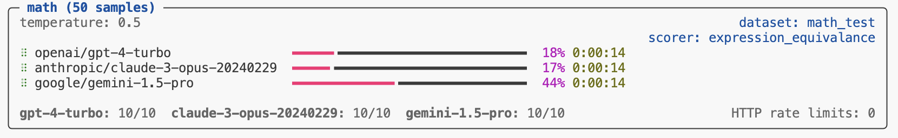

## Overview

Inspect runs evaluations using a parallel async architecture, eagerly executing many samples in parallel while at the same time ensuring that resources aren't over-saturated by enforcing various limits (e.g. maximum number of concurrent model connections, maximum number of subprocesses, etc.).

There are a progression of concurrency concerns, and while most evaluations can rely on the Inspect default behaviour, others will benefit from more customisation. Below we'll cover the following:

1.  Evaluating multiple models in parallel.
2.  Evaluating multiple tasks in parallel.
3.  Sharding one task across several worker processes.
4.  Sandbox environment concurrency.
5.  Writing parallel code in custom tools, solvers, and scorers.

::: {.callout-note appearance="simple"}
For tuning model API connection limits and rate-limit handling (`max_connections`, adaptive connections, retries) see [Model Concurrency](models-concurrency.qmd).
:::

Inspect uses [asyncio](https://docs.python.org/3/library/asyncio.html) as its async backend by default, but can also be configured to run against [trio](https://trio.readthedocs.io/en/stable/). See the section on [Async Backends](#async-backends) for additional details.

## Multiple Models {#sec-multiple-models}

You can evaluate multiple models in parallel by passing a list of models to the `eval()` function. For example:

``` python
eval("mathematics.py", model=[
    "openai/gpt-4-turbo",
    "anthropic/claude-3-opus-20240229",
    "google/gemini-2.5-pro"
])
```

{fig-alt="An evaluation task display showing the progress for 3 different models."}

Since each model provider has its own `max_connections` they don't contend with each other for resources (see [Model Concurrency](models-concurrency.qmd) for per-model tuning). If you need to evaluate multiple models, doing so concurrently is highly recommended.

If you want to specify multiple models when using the `--model` CLI argument or `INSPECT_EVAL_MODEL` environment variable, just separate the model names with commas. For example:

``` bash
INSPECT_EVAL_MODEL=openai/gpt-4-turbo,google/gemini-2.5-pro
```

## Multiple Tasks {#sec-multiple-tasks}

By default, Inspect runs a single task at a time. This is because most tasks consist of 10 or more samples, which generally means that sample parallelism is enough to make full use of the `max_connections` defined for the active model. 

If however, the number of samples per task is substantially lower than `max_connections` then you might benefit from running multiple tasks in parallel. You can do this via the `--max-tasks` CLI option or `max_tasks` parameter to the `eval()` function. For example, here we run all of the tasks in the current working directory with up to 5 tasks run in parallel:

``` bash
$ inspect eval . --max-tasks=5 
```

Another common scenario is running the same task with variations of hyperparameters (e.g. prompts, generation config, etc.). For example:

``` python
tasks = [
    Task(
        dataset=csv_dataset("dataset.csv"),
        solver=[system_message(SYSTEM_MESSAGE), generate()],
        scorer=match(),
        config=GenerateConfig(temperature=temperature),
    )
    for temperature in [0.5, 0.6, 0.7, 0.8, 0.9, 1]
]

eval(tasks, max_tasks=5)
```

It's critical to reinforce that this will only provide a performance gain if the number of samples is very small. For example, if the dataset contains 10 samples and your `max_connections` is 10, there is no gain to be had by running tasks in parallel.

Note that you can combine parallel tasks with parallel models as follows:

``` python
eval(
    tasks, # 6 tasks for various temperature values
    model=["openai/gpt-4", "anthropic/claude-haiku-4-5"],
    max_tasks=5,
)
```

This code will evaluate a total of 12 tasks (6 temperature variations against 2 models each) with up to 5 tasks run in parallel.

## Sharding {#sec-sharding}

To spread one task's samples over several processes or machines, run each part as its own worker that writes its own log (a *shard*), then merge the shards into one log with results for the whole task.

### Layout

Pick a name for the merged log, in the same form as a log file name (for example `2026-10-16T10-00-00-00-00_mytask_RLGk3vGh7Az`), and a log directory. Each worker writes to its own numbered directory under `<name>.shards/` in that log directory:

``` bash
inspect eval mytask.py --sample-id 1,2,3 \
  --log-dir logs/2026-10-16T10-00-00-00-00_mytask_RLGk3vGh7Az.shards/0
inspect eval mytask.py --sample-id 4,5,6 \
  --log-dir logs/2026-10-16T10-00-00-00-00_mytask_RLGk3vGh7Az.shards/1
```

Whoever launches the workers must:

-   Name each shard directory with digits only (`0`, `1`, ...). The merge refuses a `.shards` directory that holds any other directory.
-   Keep backslashes out of shard log file names, and so out of `INSPECT_EVAL_LOG_FILE_PATTERN`. The merge refuses a shard log whose name contains one.
-   Give each shard directory its own fixed selection, with `--sample-id` or a `--limit` range. Selections must not overlap. A worker re-run in a shard directory must select the same samples; the newest log in the directory is the one merged.
-   Run every worker with the same task, task arguments, model, scorers and epochs, from the same working directory.
-   Write the logs straight to the shard directories rather than staging them elsewhere, so `inspect view` shows them as they run.

`--limit` and `--sample-id` cannot be combined, so to shard part of a dataset, resolve it to sample ids first. Tasks that add samples while they run cannot be sharded.

### Merging

When the workers are done, merge the shards into `<name>.eval`:

``` bash
inspect log merge-shards logs/2026-10-16T10-00-00-00-00_mytask_RLGk3vGh7Az.eval
```

Or from Python with `merge_eval_log_shards()`. You can also pass the `.shards` directory. The log can be a local path, a `file://` URI or an `s3://` URL; other storage is refused.

The merge checks that the shards belong to one run, recomputes metrics over all their samples, and records which shard logs it merged. Running it again reads only the shards that changed and writes nothing if none did. If the set is not complete (a shard is still running or failed, or samples are missing) the merge raises an error and writes nothing; pass `--allow-incomplete` to write a `started` or `error` log instead. Without a selection the set is complete when the shards hold the whole dataset; pass `--sample-id` or `--sample-count` when they cover only part of it. Later merges reuse that selection.

A shard log that holds samples cancelled by `inspect ctl task drain` or `inspect ctl task cancel` is refused, before writing or deleting anything, because those samples still need to run. Run that shard again, then merge.

`--delete-shards` deletes the whole `.shards` directory after a complete merge, including any checkpoints and scan results in it.

`--json` prints one JSON object on stdout for scripts and agents. On success it has the merged log's `log`, `status`, `written`, `shards`, `samples`, `new_samples`, `missing`, `running`, `failed` and `shards_deleted`. On any failure it is `{"error": {"type": ..., "message": ...}}` and the exit code is 1; for an incomplete set the error also has `status`, `missing`, `running` and `failed`. For an unexpected error, the traceback goes to stderr. Any output from metric or reducer code goes to stderr.

The merge does not import the task file recorded in the shard logs. Every metric must be built in, come from an installed package, or be imported by you: when one is not, the merge refuses and names it. To merge a task with its own metric, import the module that defines it and call `merge_eval_log_shards()` from Python. Give your own metrics names that differ from the built-in ones or are package-qualified: a metric wrapped in `grouped()` or `aggregate()` is recorded by its short name, so a custom `mean` there cannot be told apart from the built-in `mean()`.

The merge does not recreate epoch reducers. When the task sets one (for example `epochs=Epochs(3, at_least(2, value=0.5))`), the merge uses the reduced scores each shard recorded when it finished. While a shard holding samples is still running, an incomplete merged log has no results. The merge refuses, before writing or deleting anything, when a finished shard has no recorded reductions, when a shard's log is a recovered one (`-recovered.eval`), when two of the task's reducers have the same name (`at_least(1, value=0.5)` and `at_least(1)` are both `at_least_1`), and when a score was edited with `edit_score()`, in a shard or in the merged log. Re-run the shard, or delete the merged log so the next merge rebuilds it from the shards.

While a merged log's `.shards` directory exists, `inspect score`, `score()`, `edit_score()` and `recompute_metrics()` refuse to change it, because they recreate epoch reducers from their names and would replace the reductions the shards recorded. Merge with `--delete-shards` first; for an incomplete merge, re-run the incomplete shards first, or delete the `.shards` directory by hand to abandon them. A log built in memory, with no location, is not checked.

The merge computes metrics as a fresh, unsharded run does. A scorer's metrics see each sample's metadata from the dataset, as the sample's `sample_init` event records it, not metadata a solver changed. A sample logged without its events (its record could not be serialized) is refused. A task that declares the same scorer twice is refused too, because its later scores are recorded under suffixed names that a fresh run and a retry pass to metrics differently.

A score that a solver sets (in `state.scores`) rather than a scorer the task declares is refused, before writing or deleting anything, because a fresh run and a retry pass it to metrics differently. Score with a scorer declared on the task and re-run the shards.

The merge computes metrics over the samples in sample ID order (IDs sorted as text), then epoch, and its results equal those of an unsharded run of the same samples in that order. A metric whose results depend on sample order can differ from a particular unsharded run, just as it differs between runs with `shuffle=True`.

### Limitations

-   A merge that runs while a worker is writing its shard can fail with a read error. Nothing is written; run the merge again, or merge after the workers have exited.
-   Delete shards only when every worker has exited and no other merge or deletion of the same log is running. If a deletion is interrupted, fails for some objects, or cannot be checked because the `.shards` directory cannot be listed, the merge fails and keeps the merged log; run it again or delete the `.shards` directory by hand. Until then, a merge without `--delete-shards` refuses when a shard is missing or left with an older log; if every shard still has the log that was merged, or none has a log, it returns the merged log as it is.
-   `eval_retry()` refuses a merged log that was merged with `--sample-id` or `--sample-count`. Re-run the incomplete shards and merge again instead.
-   Do not change `INSPECT_EVAL_LOG_FILE_PATTERN` while a `.shards` directory exists.
-   A metric given a function as an option, such as `mean(to_float=value_to_float(correct=2))`, is refused: the log records only the function's name. Use a registered metric that creates the function inside its factory instead (an `@metric` that returns `mean(to_float=value_to_float(correct=2))`). For the same reason, a custom metric given a string option merges only when that parameter's type annotation resolves to `str`, a number, an enum or a `Literal` of those (optionally with `None`); other types, such as `Any` or `Hashable`, can hold a function. An enum option is passed to the metric as its member; an enum combined with other types in one annotation is refused. A list or dictionary option merges only when its parameter is annotated with plain element types, such as `list[str]` or `dict[str, float]`: the log records container elements only as plain values, so containers of enums, functions or models are refused. For example, ANIMA's `dimension_normalized_avg(dims_by_name: dict[str, AnimaDimension])` is refused; wrap it in a registered metric that builds the dictionary inside its factory.
-   A shard finished with `eval_retry()` carries the reductions `eval_retry()` wrote, and `eval_retry()` loses the options of an epoch reducer (for example `at_least(2, value=0.5)`). When a reducer has options, re-run the shard instead of retrying it.
-   Do not run `inspect log recover` on a shard's log; re-run the shard instead. A shard log recovered with `--overwrite` or to another output path cannot be told apart from a finished log, and when the task sets an epoch reducer with arguments or a value converter, the merged metrics for its samples may be wrong. Default reducers are not affected.
-   For an S3 log whose location contains `*`, `?` or `[`, `--delete-shards` is refused. Delete the `.shards` directory by hand.
-   On S3, a merged log, shards directory, or any file or directory in the shards directory whose location contains `#` or `?`, a tab or line break, or a key starting with `/` is refused, by the merge and by the commands that refuse to change a merged log while its shards exist. S3 would read such a location as another key. Rename it.
-   Deleting a merged log in `inspect view` leaves its `.shards` directory, and the viewer lists the shards again. To remove a sharded run, delete the `.shards` directory as well.

## Dataset Memory {#sec-dataset-memory}

When you run an evaluation, the full dataset of samples is loaded into memory. For most evaluations this is fine, but for very large datasets (e.g. hundreds of thousands of samples with long inputs) the memory footprint can become significant. The `--max-dataset-memory` option lets you set a per-task budget (in MB) for dataset sample data. When the estimated memory exceeds this budget, samples are automatically paged to a temporary file on disk and read back on demand as each sample is executed.

``` bash
$ inspect eval --model openai/gpt-4 --max-dataset-memory 512
```

Or equivalently in Python:

``` python
eval("task.py", model="openai/gpt-4", max_dataset_memory=512)
```

By default, no memory limit is applied and all samples remain in memory.


## Sandbox Environments {#sec-parallel-tool-environments}

[Sandbox Environments](sandboxing.qmd) (e.g. Docker containers) often allocate resources on a per-sample basis, and also make use of the Inspect `subprocess()` function for executing commands within the environment.



## Solvers and Scorers {#sec-parallel-solvers-and-scorers}

### REST APIs

It's possible that your custom solvers, tools, or scorers will call other REST APIs. Two things to keep in mind when doing this are:

1.  It's critical that connections to other APIs use `async` HTTP APIs (i.e. the `httpx` module rather than the `requests` module). This is because Inspect's parallelism relies on everything being `async`, so if you make a blocking HTTP call with `requests` it will actually hold up all of the rest of the work in the system!

2.  As with model APIs, rate limits may be in play, so it's important not to over-saturate these connections. Recall that Inspect runs all samples in parallel so if you have 500 samples and don't do anything to limit concurrency, you will likely end up making hundreds of calls at a time to the API.

Here's some (oversimplified) example code that illustrates how to call a REST API within an Inspect component. We use the `async` interface of the `httpx` module, and we use Inspect's `concurrency()` function to limit simultaneous connections to 10:

``` python
import httpx
from inspect_ai.util import concurrency
from inspect_ai.solver import Generate, TaskState

client = httpx.AsyncClient()

async def solve(state: TaskState, generate: Generate):
  ...
  # wrap the call to client.get() in an async concurrency 
  # block to limit simultaneous connections to 10
  async with concurrency("my-rest-api", 10):
    response = await client.get("https://example.com/api")
```

Note that we pass a name ("my-rest-api") to the `concurrency()` function. This provides a named scope for managing concurrency for calls to that specific API/service.

### Parallel Code {#sec-parallel-code}

Generally speaking, you should try to make all of the code you write within Inspect solvers, tools, and scorers as parallel as possible. The main idea is to eagerly post as much work as you can, and then allow the various concurrency gates described above to take care of not overloading remote APIs or local resources. There are two keys to writing parallel code:

1.  Use `async` for all potentially expensive operations. If you are calling a remote API, use the `httpx.AsyncClient`. If you are running local code, use the `subprocess()` function described above.
2.  If your `async` work can be parallelised, do it using `asyncio.gather()`. For example, if you are calling three different model APIs to score a task, you can call them all in parallel. Or if you need to retrieve 10 web pages you don't need to do it in a loop—rather, you can fetch them all at once.

#### Model Requests

Let's say you have a scorer that uses three different models to score based on majority vote. You could make all of the model API calls in parallel as follows:

``` python
from inspect_ai.model import get_model

models = [
  get_model("openai/gpt-5"),
  get_model("anthropic/claude-sonnet-4-5"),
  get_model("mistral/mistral-large-latest")
]

output = "Output to be scored"
prompt = f"Could you please score the following output?\n\n{output}"

graders = [model.generate(prompt) for model in models]

grader_outputs = await asyncio.gather(*graders)
```

Note that we don't await the call to `model.generate()` when building our list of graders. Rather the call to `asyncio.gather()` will await each of these requests and return when they have all completed. Inspect's internal handling of `max_connections` for model APIs will throttle these requests, so there is no need to worry about how many you put in flight.

#### Web Requests

Here's an example of using `asyncio.gather()` to parallelise web requests:

``` python
import asyncio
import httpx
client = httpx.AsyncClient()

pages = [
  "https://www.openai.com",
  "https://www.anthropic.com",
  "https://www.google.com",
  "https://mistral.ai/"
]

downloads = [client.get(page) for page in pages]

results = await asyncio.gather(*downloads)
```

Note that we don't `await` the client requests when building up our list of `downloads`. Rather, we let `asyncio.gather()` await all of them, returning only when all of the results are available. Compared to looping over each page download this will execute much, much quicker. Note that if you are sending requests to a REST API that might have rate limits, you should consider wrapping your HTTP requests in a `concurrency()` block. For example:

``` python
from inspect_ai.util import concurrency

async def download(page):
  async with concurrency("my-web-api", 2):
    return await client.get(page)
  
downloads = [download(page) for page in pages]

results = await asyncio.gather(*downloads)
```

### Subprocesses

It's possible that your custom solvers, tools, or scorers will need to launch child processes to perform various tasks. Subprocesses have similar considerations as calling APIs: you want to make sure that they don't block the rest of the work in Inspect (so they should be invoked with `async`) and you also want to make sure they don't provide *too much* concurrency (i.e. you wouldn't want to launch 200 processes at once on a 4 core machine!)

To assist with this, Inspect provides the `subprocess()` function. This `async` function takes a command and arguments and invokes the specified command asynchronously, collecting and returning stdout and stderr. The `subprocess()` function also automatically limits concurrent child processes to the number of processors available to the eval (under a container CPU limit such as `docker --cpus` or a Kubernetes `limits.cpu`, that limit rather than the host's processor count). Here's an example from the implementation of a `list_files()` tool:

``` python
@tool
def list_files():
    async def execute(dir: str):
        """List the files in a directory.

        Args:
            dir: Directory

        Returns:
            File listing of the directory
        """
        result = await subprocess(["ls", dir])
        if result.success:
            return result.stdout
        else:
            raise ToolError(result.stderr)

    return execute
```

The maximum number of concurrent subprocesses can be modified using the `--max-subprocesses` option. For example:

``` bash
$ inspect eval --model openai/gpt-4 --max-subprocesses 4
```

Note that if you need to execute computationally expensive code in an eval, you should always factor it into a call to `subprocess()` so that you get optimal concurrency and performance.

#### Timeouts

If you need to ensure that your subprocess runs for no longer than a specified interval, you can use the `timeout` option. For example:

``` python
try:
  result = await subprocess(["ls", dir], timeout = 30)
except TimeoutError:
  ...
```

If a timeout occurs, then a `TimeoutError` will be thrown (which your code should generally handle in whatever manner is appropriate).


## Async Backends

Inspect asynchronous code is written using the [AnyIO](https://anyio.readthedocs.io/en/stable/) library, which is an async backend independent implementation of async primitives (e.g. tasks, synchronization, subprocesses, streams, etc.).

AnyIO in turn supports two backends: Python's built-in [asyncio](https://docs.python.org/3/library/asyncio.html) library as well as the [Trio](https://trio.readthedocs.io/en/stable/) async framework. By default, Inspect uses asyncio and is compatible with user code that uses native asyncio functions.

### Using Trio

To configure Inspect to use Trio, set the `INSPECT_ASYNC_BACKEND` environment variable:

```bash
export INSPECT_ASYNC_BACKEND=trio
inspect eval math.py
```

Note that there are some features of Inspect that do not yet work when using Trio, including:

1. Full screen task display uses the [textual](https://textual.textualize.io/) framework, which currently works only with asyncio. Inspect will automatically switch to "rich" task display (which is less interactive) when using Trio.

2. Interaction with AWS S3 (e.g. for log storage) uses the [s3fs](https://s3fs.readthedocs.io/en/latest/) package, which currently works only with asyncio.

3. The [Bedrock](providers.qmd#aws-bedrock) and [Grok](providers.qmd#grok) providers depend on asyncio so cannot be used with the Trio backend.

4. The `--acp-server` option (which exposes a running eval over the Agent Client Protocol so external editors can attach) depends on the asyncio-only `acp` library. Inspect raises a clear startup error if `--acp-server` is specified while the Trio backend is configured. Evals that don't use `--acp-server` are unaffected and run normally under Trio.

### Portable Async

If you are writing async code in your Inspect solvers, tools, scorers, or extensions, you should whenever possible use the [AnyIO](https://anyio.readthedocs.io/en/stable/) library rather than asyncio. If you do this, your Inspect code will work correctly no matter what async backend is in use.

AnyIO implements Trio-like [structured concurrency](https://en.wikipedia.org/wiki/Structured_concurrency) (SC) on top of asyncio and works in harmony with the native SC of Trio itself.

To learn more about AnyIO see the following resources:

- <https://anyio.readthedocs.io/>

- <https://lewoudar.medium.com/anyio-all-you-need-for-async-programming-stuff-4cd084d0f6bd>

