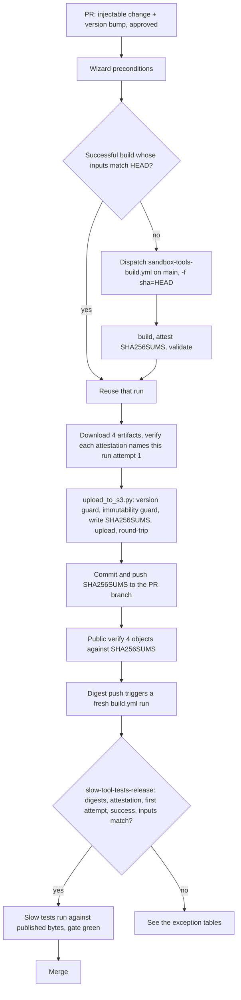

# Sandbox tools release flow

A walkthrough of the release wizard, the CI build, and the release gate: the
normal success path, then every failure with what triggers it, what the
operator sees, and how to recover.

For what each command and file does, see [RELEASING.md](RELEASING.md). For the
agent procedure, see the `release-sandbox-tools` skill
(`.agents/skills/release-sandbox-tools/SKILL.md`). This document owns the flow
and the recovery steps; those two point here rather than repeat them.

## The pieces

- `scripts/release-sandbox-tools.sh`, the wizard. Six stages: preconditions,
  CI build, S3 upload, digest commit, public verify, get CI green. Run from a
  checkout of the PR head, by a maintainer with S3 credentials.
- `.github/workflows/sandbox-tools-build.yml`, the build. Builds the four
  binaries on `main` at a given `sha`, writes `SHA256SUMS`, attests the
  artifacts, then validates them. Holds no AWS credentials and publishes
  nothing.
- `src/inspect_ai/tool/_sandbox_tools_utils/upload_to_s3.py`, the uploader and
  the only writer of `SHA256SUMS`. Guards the version and immutability, then
  round-trips each object.
- `check-version-bump` and `slow-tool-tests-release` in
  `.github/workflows/build.yml`, the PR gates. The first is fast and cheap; the
  second proves the published bytes were built in CI from the PR's inputs.

## Invariants

These four facts explain every recovery below.

1. Published S3 bytes are immutable. The uploader refuses to overwrite an
   object with different bytes. Re-uploading identical bytes is allowed, which
   is what makes a retry safe.
2. Only a build run that succeeded on its first attempt counts. A re-run can
   pair bytes signed by one attempt with a result from another, so both the
   wizard and the gate reject attempt greater than 1.
3. The published bytes must have been built from the PR's build inputs.
   `SHA256SUMS` is not a build input, so committing the digests does not change
   them. The build inputs are listed in RELEASING.md.
4. The version is a canonical positive integer above `main`. Any forward bump
   is accepted, and the number is only an artifact label, so skipping a burned
   number is harmless at runtime.

## Normal success path

Step by step:

1. The PR has an injectable change under `src/inspect_sandbox_tools/` and a
   version bump, and it is approved.
2. Preconditions (stage 1): on the PR head branch, PR approved, checkout at the
   PR head, version canonical and above `main`, no stray uncommitted
   build-input changes, and merging upstream main (as of the last fetch) would
   leave the build inputs unchanged (merge main into the branch first if it
   would not).
3. CI build (stage 2): the wizard looks for a successful first-attempt run
   whose built commit has the same build inputs as HEAD. On a commit's first
   release there is none, so it dispatches `sandbox-tools-build.yml` on `main`
   with `-f sha=HEAD` and waits. The matrix builds four variants, the attest
   job writes `SHA256SUMS` and signs the artifacts, and validation runs after
   signing. The run is titled `Build sandbox tools at {SHA}`.
4. Download and verify (stage 2): the wizard downloads the four artifacts and
   checks that each one's attestation names this run's first attempt.
5. Upload (stage 3): `upload_to_s3.py` checks the version matches the committed
   file, hashes the four local artifacts, refuses any already published with
   different bytes, rewrites `SHA256SUMS`, uploads, and round-trip verifies
   each object.
6. Digest commit (stage 4): the wizard commits `SHA256SUMS` as
   `Pin sandbox-tools v{V} artifact digests` and pushes it to the PR branch.
7. Public verify (stage 5): downloads the four public objects and checks them
   against the committed `SHA256SUMS`.
8. Gate (stage 6 and CI): the digest push triggers a fresh `build.yml` run, and
   the maintainer can also rerun `slow-tool-tests-release` from the Actions UI.
   The gate checks the four digests are present and lockstepped to the version,
   fetches each object and checks it against the committed digest, verifies each
   attestation, confirms the signing run succeeded on its first attempt, reads
   the built commit from the run title, and fails unless its build inputs match
   the PR's. It then runs the slow tests against the published binaries.
9. Merge once the gate is green.

## When main moves under the PR

Upstream requires the PR branch to be up to date before merge, which forces
merging `main` into it. What happens next depends on what moved.

- A non-build-input change (anything outside the build inputs, including the
  excluded `design/`, `tests/`, and `SHA256SUMS`): the build inputs are
  unchanged, so the gate still passes and a wizard re-run reuses the existing
  build. Nothing to redo.
- A build-input change (anything else under `src/inspect_sandbox_tools/`,
  `_sandbox_tools_utils/`, or `binaries/`): the timing decides the cost. Stage 1
  and the stage-3 pre-upload re-check compute the merge with upstream main (as of
  their last fetch) and stop the wizard with "merge main first" when it would
  change the build inputs, so nothing is published and no version is burned;
  merge main into the branch, push, and re-run. If main moves in the build inputs
  after that last check, or after the upload, the published bytes no longer match
  the PR merge and the version is burned; recover with R2.

The same split applies to a push to the PR branch after upload: a non-build-input
push is fine, a build-input push burns the version.

## More than one matching build

More than one successful first-attempt run can have build inputs equal to HEAD: a
re-dispatch (for example after Ctrl-C mid-build) or a manual dispatch. Because the
build is not reproducible, their bytes differ. The wizard reuses the newest and,
before dispatching, waits on an in-progress run for the commit rather than
starting a duplicate, so this stays uncommon.

If a different matching run's bytes are already published for the version, a
re-run that selects the newer run re-uploads and trips the immutability guard.
Those published bytes are still valid CI output for these inputs, so do not bump.
Bump only when a build input actually changed.

How to finish depends on how far the already-published run got. If all four of
its objects were published and its `SHA256SUMS` was committed and pushed, the
release is already complete: rerun the gate and ignore this build. If its upload
was interrupted or its digest commit was never pushed, the wizard cannot finish
it (it keeps selecting the newer run and tripping the guard), so finish that run
by hand. With RUN the run whose bytes are published:

1. `gh run download RUN --repo UKGovernmentBEIS/inspect_ai -n sandbox-tools-v{V} -D src/inspect_ai/binaries`
   (the four artifacts land flat, named `inspect-sandbox-tools-{arch}[-musl]-v{V}`).
2. Verify each artifact's attestation as stage 2 does (`gh attestation verify`).
3. `python src/inspect_ai/tool/_sandbox_tools_utils/upload_to_s3.py {V}`: identical
   bytes re-upload is allowed, so it uploads any missing objects and rewrites
   `SHA256SUMS`.
4. Commit and push `SHA256SUMS` to the PR branch, then rerun the gate.

## Recovery archetypes

The tables below reference these.

- R1, finish the release. Re-run the wizard. It reuses the existing build and
  completes the upload and the digest commit. Every step is idempotent.
- R2, burn and bump. The published bytes can no longer match the PR. Set
  `sandbox_tools_version.txt` to any number above `main`, skipping the burned
  one, commit it, and re-run the wizard, which dispatches a fresh build at the
  new head and publishes it. Rerun the gate.
- R3, fresh build run. Get a new successful first-attempt run to become the
  newest matching candidate. For a failed run or a re-run (attempt greater than
  1), re-running the wizard dispatches one, since neither is reused. For a
  successful first-attempt run that keeps being reselected (its artifacts
  expired, or its attestation fails to verify), dispatch one yourself so a newer
  run exists:
  `gh workflow run sandbox-tools-build.yml --repo UKGovernmentBEIS/inspect_ai --ref main -f sha=<HEAD>`,
  then re-run the wizard. GitHub's re-run buttons do not help, because only a
  first attempt counts.
- R4, fix the PR. Correct the version file or the change set as the message
  says, commit, re-run.

## Exception paths

### Preconditions and version (wizard stage 1, check-version-bump)

| Trigger | What you see | Recovery |
|---|---|---|
| Wrong branch, PR not approved, or checkout not at the PR head | "Check out the PR's head branch, then re-run.", "PR is not approved", or "This checkout is at ... but PR #N's head is ..." | Align the branch, approval, or checkout, then re-run (R4) |
| Merging upstream main would change the build inputs, or the branch conflicts with main (stage 1, or the stage-3 pre-upload re-check) | "merging main changes the build inputs" or "This branch conflicts with main" | Merge main into the PR branch, push, re-run (R4); nothing is published, so no burn |
| Version not a canonical integer | wizard "must be a positive integer, not", gate "must be a positive integer, not v" | Set the version file to a plain positive integer, commit, re-run (R4) |
| Injectable changed but version not above `main` | wizard "CI requires a version above v", gate "bump it above v" | Bump above `main`, commit, re-run (R4) |
| Version changed with no injectable change | gate "changed to v... but src/inspect_sandbox_tools/ is unchanged" | Revert the version or include the injectable change (R4) |
| `SHA256SUMS` changed with no version bump | gate "Digests for a published version are immutable" | Bump the version and publish fresh (R2) |

### Build and attest (wizard stage 2, build run, gate)

| Trigger | What you see | Recovery |
|---|---|---|
| Dispatched run never appeared | "The dispatched run didn't appear" | Re-run the wizard; it waits on the run if the dispatch registered, otherwise dispatches one (R1) |
| Build run failed | "CI build failed" | Fix the PR (R4), or for a flake re-run the wizard, which dispatches a new build (R3) |
| Picked run was re-run before download (attempt > 1) | wizard "only a first attempt counts" | Re-run the wizard; the attempt-2 run is no longer reused, so a fresh build is dispatched (R3) |
| Reused run's artifact is missing or its attestation fails at download | "has no inspect-sandbox-tools", "Attestation check failed", or "not run ... attempt 1" | The same run keeps being reselected; dispatch a fresh build, then re-run (R3) |
| Signing run did not succeed or was re-run (gate, after publication) | "which did not succeed" or "was re-run (attempt" | R2 (the bytes are published; fresh bytes would hit the immutability guard) |
| No valid attestation on the S3 object (gate) | "has no valid attestation from sandbox-tools-build.yml on main" | R2 |
| Built commit's inputs differ from the PR (gate) | "whose build inputs differ from this PR" | R2 |
| Built commit unreadable from the run title (gate) | "Can't read the built commit from run" | R2 |
| Symlink in the build inputs (gate) | "Symlinks in the sandbox tools build inputs ... aren't allowed" | Replace it with a regular file (R4); if bytes were already published, also R2 |

### Upload and publish (wizard stage 3, upload_to_s3.py)

| Trigger | What you see | Recovery |
|---|---|---|
| Object already published with different bytes | upload "is already published with different bytes", wizard "If it hit the immutability guard" | If a build input changed, R2. If the bytes are from another valid CI run of these same inputs, keep the published bytes, no bump, and finish from that run (see More than one matching build) |
| Upload interrupted part way (crash or Ctrl-C) | some objects on S3, `SHA256SUMS` rewritten but uncommitted; the gate later 404s on the missing object | Re-run the wizard; re-upload is idempotent for identical bytes and finishes the rest (R1) |
| Round-trip verify mismatch | "does not match the local digest" | Transient (the just-uploaded object read back short); re-run the upload (R1). A pre-existing wrong object cannot reach here, it trips the immutability guard above |
| Local artifact missing | "not found" | Re-run the wizard so the download repopulates `binaries/` (R1) |

### Digests, verify, and the gate (wizard stages 4-6, slow-tool-tests-release)

| Trigger | What you see | Recovery |
|---|---|---|
| Digests already committed | "digests are already committed" | None; the wizard continues |
| Wizard did not push the digest commit | "remember to commit and push it yourself" | Commit and push `SHA256SUMS` to the PR branch (R1) |
| `SHA256SUMS` not rewritten for the version (gate) | "is not updated for v" | Run the wizard; stage 3 rewrites it and stage 4 commits it (R1) |
| Published object missing, gate 404 | "not found at" | Finish the upload by re-running the wizard (R1) |
| Malformed `SHA256SUMS` entry (gate) | "Expected exactly one ... entry" | Re-run the wizard to rewrite `SHA256SUMS` (R1) |
| Public object does not match the committed digest | wizard "do NOT merge", gate "does not match the digests committed in this PR. Do NOT re-upload over it" | If the read was transient, R1. If the published bytes are persistently wrong, investigate and R2. Never re-upload over it |

## Re-running and Ctrl-C

The wizard is safe to stop with Ctrl-C and re-run; it resumes. What each stage
leaves, and what a re-run does:

| Stopped at | State left behind | A re-run |
|---|---|---|
| Stage 1, preconditions | nothing | starts over |
| Stage 2, build | perhaps a dispatched build run on `main`; nothing published | reuses the run if it finished successfully, waits on it if still running, or dispatches one if none exists |
| Stage 3, upload | some or all objects on S3; `SHA256SUMS` rewritten locally, uncommitted | reuses the build, re-uploads idempotently, round-trip verifies |
| Stage 4, after the digest commit but before the push | a local digest commit sits ahead of the PR head | stage 1's head check fails ("This checkout is at ... but PR #N's head is"); push the existing commit, then re-run |
| Stage 4, after the digest commit is pushed | `SHA256SUMS` committed and pushed; HEAD is now the digest commit | reuse still matches, since `SHA256SUMS` is not a build input; stage 3 re-upload is idempotent; stage 4 reports "digests are already committed" |
| Stage 5-6 | published and committed | idempotent; re-verifies and watches the gate |
